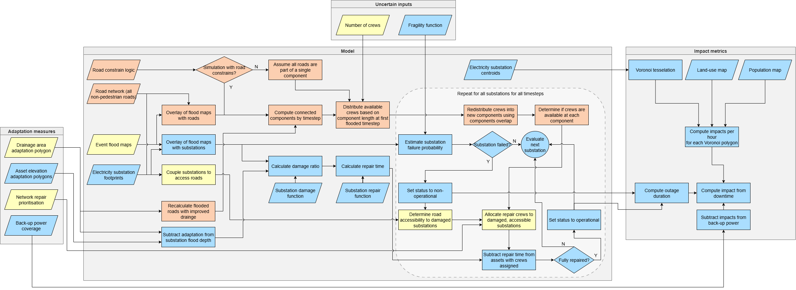

 (https://doi.org/10.5281/zenodo.20731868)

# PowerPath
## A critical infrastructure risk, resilience, and adaptation model
This repository contains a time‑explicit disruption and recovery model to represent the coupled behaviour of electricity substations and the road network during and after a flooding event. The model simulates, at each timestep, flood exposure, substation failure, road accessibility, repair crew allocation, and recovery, and translates these processes into spatially distributed impacts

See the [module architecture map](docs/module-map.md) for a contributor-oriented overview of the current architecture.

### MIRACA
This work has received funding from the European Union’s Horizon Europe research and innovation programme under grant agreement No. 101093854 for the project ‘Multi-hazard Infrastructure Risk Assessment for Climate Adaptation’ (MIRACA, https://miraca-project.eu)

### Acknowledgements
This model builds on several open-source tools:
- [RA2CE](https://github.com/Deltares/ra2ce) (Deltares) for road-network hazard overlay and criticality analysis.
- [EMA Workbench](https://github.com/quaquel/EMAworkbench) (Kwakkel, J.H., *The Exploratory Modeling Workbench: An open source toolkit for exploratory modeling, scenario discovery, and (multi-objective) robust decision making*, Environmental Modelling & Software, 2017) for scenario exploration.
- Hazard-value extraction at asset locations (`src/hazard_analysis_electricity.py`) uses [exactextract](https://github.com/isciences/exactextract) for coverage-weighted zonal statistics, following the approach used in [DamageScanner](https://github.com/VU-IVM/DamageScanner) (Koks, E.E. and de Bruijn, J., *DamageScanner: Python tool for natural hazard damage assessments*, https://doi.org/10.5281/zenodo.2551015).
